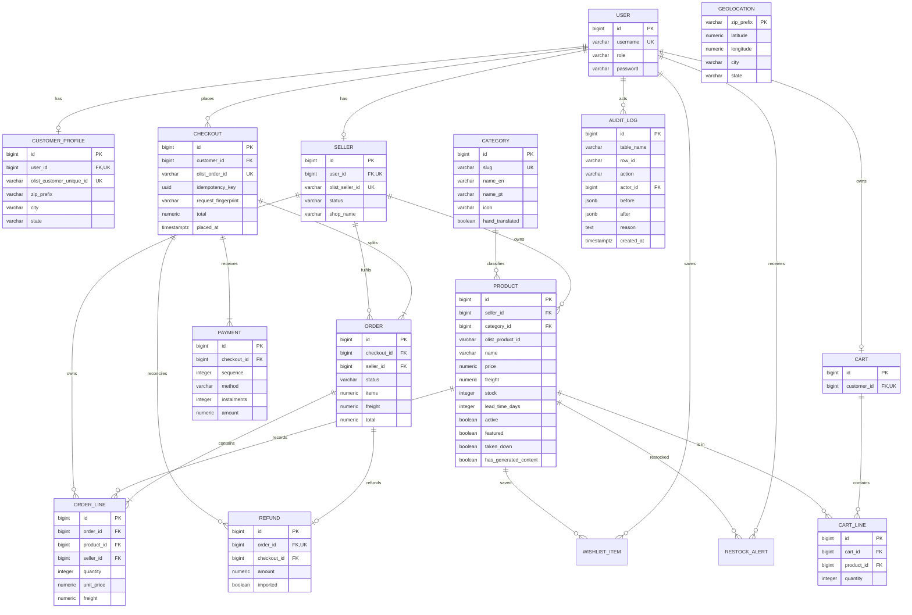

# Data model

The field ownership contract is in [AGENTS.md](../AGENTS.md#architecture-and-ownership). PostgreSQL owns accounts,
product names and every transactional value; MongoDB owns descriptions, flexible attributes and reviews. Source Olist
files remain unchanged in `data/raw/olist/`, with SHA-256 checksums and [licence attribution](licenses/olist.txt).
The executable contract is [olist-import](plans/olist-import.md).

## PostgreSQL

All application surrogate keys are bigint identities. Olist identifiers are nullable source columns, never primary
keys. Money is `numeric(12,2)` with bounds that also reject PostgreSQL numeric NaN and infinity. Dates are timestamptz;
source timestamps shift by exactly 426 weeks and acquire Asia/Singapore local time before conversion to a stored instant.
Zip prefixes are strings, preserving leading zeros. They deliberately have no geolocation FK because source coverage is
incomplete. Ordinary CRUD uses Django's ORM; the bulk loader uses COPY.

### Tables and integrity

| Django model / physical table | Additional fields and database guarantees |
|---|---|
| accounts.User / accounts_user | AbstractUser's auth fields, groups and permissions; role CHECK allows customer, seller or operator. Imported passwords are unusable; no hashing in the loader. Django's standard auth join tables and session table remain |
| CustomerProfile / accounts_customerprofile | One user per profile and one profile per user; unique Olist customer identity. Multiple source customer addresses collapse to the latest retained purchase address, then source customer ID |
| Seller / accounts_seller | One user per seller; unique Olist seller ID; status CHECK includes pending, approved, rejected and suspended. Generated shop names carry has_generated_content |
| Category / catalogue_category | Unique English slug; English/Portuguese names, one sprite icon mapping and the hand_translated flag. Rich category definitions live in MongoDB |
| Product / catalogue_product | Unique (seller_id, olist_product_id) and (id, seller_id). Positive finite price; nonnegative finite freight, stock and lead time; stock at most 1,000,000 (`product_stock_capped`; sellers can enter at most 99,999, leaving room for cancellation restocks). Nullable weight_g, length_cm, height_cm and width_cm; active, featured, taken_down, taken_down_reason, has_generated_content and demo_adjustment. Historical products are protected from deletion. GIN trigram index `product_name_trgm` on name |
| Cart / orders_cart | One cart per customer (unique customer_id). Its row is the lock that serializes cart edits and checkout |
| CartLine / orders_cartline | Unique (cart_id, product_id); quantity CHECK 1 to 999. Products in a cart are protected from deletion. Only products in purchasable_product can be added, and lines that leave the view are refused at checkout |
| Checkout / orders_checkout | customer_id references the user's ID. Unique (customer_id, idempotency_key); imported keys are null, Olist order ID is unique. Nonnegative finite total. request_fingerprint stores the 64-character digest of the reviewed lines (product, quantity, unit price, freight), so a resubmitted key replays only the same reviewed cart; imported history keeps the empty database default |
| Order / orders_order | Unique (checkout_id, seller_id), (id, seller_id) and (id, checkout_id). Status CHECK: placed, paid, shipped, delivered, cancelled. Nonnegative finite items/freight/total; total = items + freight. placed_at, paid_at, shipped_at, delivered_at, cancelled_at, estimated_delivery. Index on (seller_id, placed_at) |
| OrderLine / orders_orderline | Positive quantity and unit price; nonnegative freight. Composite FKs (order_id, seller_id) and (product_id, seller_id) enforce ownership with ON DELETE RESTRICT. shipping_limit_at is the earliest original item's shifted deadline when repeated lines collapse |
| Payment / orders_payment | Unique (checkout_id, sequence); positive sequence and instalments. Method CHECK: credit_card, boleto, voucher, debit_card; nonnegative finite amount. A row means money received; there is no payment-status column and no card-number field |
| Refund / orders_refund | At most one per order; composite FK (order_id, checkout_id) prevents cross-checkout refunds. Nonnegative finite amount; reason, refunded_at and imported. Imported cancellations with payments receive their full order total |
| AuditLog / audit_log | Written only by owner-owned triggers and the narrow review moderation function. table_name, row_id as text (so MongoDB IDs also fit), action, nullable actor FK (PROTECT; NULL means a system change), before/after JSONB snapshots of named fields only, reason and created_at (database default now()). CHECKs: identity fields nonblank; a non-NULL actor needs a non-blank reason. Indexes: (created_at DESC, id DESC) for the newest-first page, and action |
| Geolocation / accounts_geolocation | One row per zip prefix, median coordinates and separate modal city/state (lexical tie-break). Coordinates use exact numeric columns |

Django creates B-tree indexes for ordinary FKs, primary keys and unique constraints. The initial migrations are
`src/accounts/migrations/0001_initial.py`, `src/catalogue/migrations/0001_initial.py` and
`src/orders/migrations/0001_initial.py`. The composite FKs are explicit migration SQL because Django does not express
these two-column relationships as ordinary ForeignKey fields.

### Wishlist and restock alerts

`wishlist_item` is the many-to-many table: customer_id (accounts_user FK), product_id (catalogue_product FK),
added_at (timestamptz, default now), with the composite primary key (customer_id, product_id). `restock_alert`
has a bigint identity, the same two FKs, created_at (timestamptz, default now) and nullable seen_at. Both FKs cascade
on deletion. `restock_one_unseen` is a partial UNIQUE index on (customer_id, product_id) WHERE seen_at IS NULL;
`restock_customer_newest` indexes (customer_id, created_at DESC).

`product_restock_alert` is an AFTER UPDATE OF stock trigger on catalogue_product, guarded by OLD.stock = 0 AND
NEW.stock > 0. Its pinned-search-path function alert_product_restock inserts one row per saved customer through
INSERT … SELECT … ON CONFLICT (customer_id, product_id) WHERE seen_at IS NULL DO NOTHING. It runs with the caller's
row privileges; runtime already has row DML and receives no ownership rights. product_update_audit remains a separate
trigger on the same table. Raw SQL, seller edits and cancellation restocks all fire both relevant triggers.

### View, triggers and privileges

`purchasable_product` is the single visibility definition: an active product, not taken down, belonging to an approved
seller. It includes sold-out products. It uses security_invoker and exposes product rows. The minimum pages query its
IDs through an unmanaged ORM model. Later workstreams reuse this definition.

The customer_profile_role and seller_profile_role triggers require the linked user's role to match the profile;
user_profile_role prevents changing a role while an incompatible profile exists. The profile check locks the user row
in SHARE mode. These are schema guards; the seller status and audit triggers come from accounts, and the order
status, order audit and money triggers from checkout (all described below). The importer disables USER triggers only on loaded tables, retains FK/check/unique
constraints, flushes deferred FK events before restoring triggers, and runs the explicit reconciliation queries.
A failed transaction rolls back COPY and trigger changes together.
The loader requires a standalone owner transaction, so it cannot commit MongoDB inside a caller's uncommitted
PostgreSQL transaction. Compensation removes only IDs attempted by that import. An uncertain final commit or failed
cleanup is reported as requiring the documented local reset, without claiming a distributed atomic commit.
MongoDB loads commit bounded batches to respect transaction lifetime/cache limits; later failures compensate already
committed batches as well as the current batch. Progress is printed during large collection loads.

**Seller status and audit (`accounts` 0002).** seller_status_transition (BEFORE UPDATE, only
`WHEN (OLD.status IS DISTINCT FROM NEW.status)`) allows pending → approved or rejected, approved → suspended and
suspended → approved; rejected is terminal, and any other change fails with SQLSTATE 23514. Unchanged status and
shop-name edits pass without an audit row. seller_status_audit (AFTER UPDATE, same WHEN) inserts one audit_log row named
seller.approve, seller.reject, seller.suspend or seller.reinstate in the same transaction, with id, user_id, status and
shop_name snapshots. Its actor and reason come from the transaction-local settings `mercer.actor_id` and
`mercer.audit_reason`, which [accounts/audit.py](../src/accounts/audit.py) sets together with bound `set_config(..., true)`
on every action and which clear at commit or rollback; the trigger reads them with `NULLIF(current_setting(..., true), '')`.
The operator service locks the seller row (`SELECT ... FOR UPDATE`), rechecks the expected status, sets the context and
updates, so a stale or repeated action fails without a second row. Suspension hides products through
purchasable_product; reinstatement restores those otherwise eligible.

Both functions are owned by the migration owner, schema-qualified and pinned to `search_path = public, pg_temp`; only
the audit function is SECURITY DEFINER, because it alone writes a table the runtime role cannot. The migration revokes
runtime INSERT, UPDATE, DELETE and TRUNCATE on audit_log and every privilege on its identity sequence, keeping SELECT;
`grant_runtime` reapplies this after its broad grants (`TRIGGER_WRITTEN_TABLES` in
[config/privileges.py](../src/config/privileges.py)), so rerunning it cannot restore audit writes. Runtime cannot own or
replace functions, disable triggers, create temporary objects or change session_replication_role. Revoking PUBLIC
EXECUTE on the functions is hygiene only. Later catalogue and checkout triggers reuse this boundary.

**Order lifecycle and money (`orders` 0002).** order_status_transition (BEFORE UPDATE, only when the status changes)
permits placed → paid or cancelled, paid → shipped or cancelled and shipped → delivered, and stamps the destination's
timestamp. order_status_audit writes named before/after status snapshots to audit_log on the same owner-owned,
SECURITY DEFINER boundary as the seller audit, with PUBLIC EXECUTE revoked. check_checkout_money and
check_checkout_refunds run as deferred constraint triggers (`DEFERRABLE INITIALLY DEFERRED`) on every insert, update or
delete of checkouts, orders, payments and refunds: at commit they lock the affected checkouts in id order (both the old
and new parent after a move) and require payments = checkout total = sum of order totals, and refunds = totals of the
cancelled orders. All money arithmetic is PostgreSQL numeric or Python Decimal. New purchases charge freight per unit
(product freight × quantity) and estimate delivery as the placed time plus the longest product lead time plus 15 days.
Per-order refund matching (the refund belongs to the cancelled order and equals that order's total) and order-line
consistency (order items = sum of quantity × unit price; order freight = sum of line freight) are enforced by the
checkout service and checked by `verify_olist`'s `refund_totals` and `order_line_totals` invariant queries, rather than
database triggers. Direct SQL can still violate these two rules; the deferred triggers enforce checkout-level sums.
The importer disables these USER triggers while loading and checks the same invariants with its reconciliation
queries; imported-refund provenance is checked during import only, so a later customer cancellation of imported paid
history adds a new, non-imported refund that the triggers still balance.

**Row-lock order (checkout-i10).** Paths taking both seller and product locks take sellers first, then products;
multiple rows of either type are locked in ascending id order. Checkout locks cart → cart lines → sellers (`FOR
SHARE`) → products (`FOR UPDATE`). It discovers seller ids through an unlocked cart-line/product join, then rechecks
each locked product's seller against the sellers actually locked, refusing changed ownership with `CartChangedError`.
Visibility, fingerprint, price and stock checks still follow the product lock. Seller locks remain held through commit,
so a seller suspension waits for an in-flight purchase, and a checkout after suspension is refused.

| Path | Locks and relationship to the order |
|---|---|
| `orders.services.checkout` | Cart, cart lines, sellers in id order, products in id order; its newly inserted checkout/orders are private to the transaction |
| `orders.services.change_order_status` | Existing checkout → order → products in id order for cancellation; shipping and delivery stop at the order; the seller join is an unlocked permission read |
| `catalogue.services.save_product` / `deactivate_product` | Seller `FOR UPDATE` → its product `FOR UPDATE`; creating a product locks its seller before inserting |
| `accounts.audit.change_seller_status` | Seller `FOR UPDATE` only; visibility changes through `purchasable_product`, without locking product rows |
| `catalogue.services.moderate_product` | Product `FOR UPDATE` only; no seller lock |
| Wishlist restock trigger | Runs while its caller holds the updated product; reads wishlist rows and inserts alerts, without an additional seller/product row lock |
| `import_olist` | Owner-only empty-database setup, advisory import lock, table locks while disabling USER triggers, then COPY in dependency order; outside concurrent application row writes |
| `seed_demo` | Owner setup transaction; the only seller write inserts the pending applicant before product stock adjustments; existing sellers are read without row locks |

The lifecycle branch remains checkout → order → products and never locks a seller after a product. Deterministic
real-connection tests in [test_checkout_concurrency.py](../tests/test_checkout_concurrency.py) cover checkout against
catalogue deactivation in either direction, opposite-order multi-product carts (including observation of the actual
first row lock), and suspension waiting through purchase commit. These establish the tested serialization paths;
they are not a blanket guarantee against every possible database deadlock.

The first accounts migration grants the runtime role access to tables/sequences and installs default privileges for
later owner-created objects. It applies equally to mercer and pytest's test_mercer. PUBLIC database privileges and
schema CREATE are revoked; runtime receives CONNECT, schema USAGE, row DML and sequence USAGE/SELECT, without CREATE,
TEMP, DROP, ALTER or TRUNCATE. The owner remains responsible for migrations, tests and import. Role identifiers are
quoted with psycopg Identifier; data values are bound parameters.
`django_migrations` is an explicit exception to row DML: runtime has SELECT only and no access to its identity
sequence, so only the owner can modify migration history in either the application or test database.
The orders `0003_protect_money_deletes` migration additionally revokes runtime DELETE on `orders_checkout`,
`orders_order`, `orders_orderline`, `orders_payment` and `orders_refund`, retaining SELECT, INSERT and UPDATE. The
`NO_DELETE_TABLES` restriction in [config/privileges.py](../src/config/privileges.py) is reapplied after every broad
`grant_runtime` call, so a rerun cannot restore DELETE. The owner's privileges are unchanged; carts and cart lines
retain the DELETE privilege needed by the application. This prevents erasing a paid checkout or bypassing the
UPDATE-only lifecycle/audit triggers by deleting and reinserting a shipped order (checkout-i11).

**Product search and audit (`catalogue` 0002).** The trusted pg_trgm extension and the `product_name_trgm` GIN index
on product.name serve typo-tolerant name search. product_update_audit (AFTER UPDATE, only when price, stock, active or
taken_down actually changes) runs the owner-owned SECURITY DEFINER function `public.audit_product_update()` with
`search_path = public, pg_temp`; it reads the same transaction-local actor and reason and writes named-field
before/after snapshots. Checkout's stock decrements and cancellation restocks therefore leave product audit rows
with the buyer as actor. Runtime keeps SELECT only on audit_log and cannot execute or replace the function or disable
its trigger.

**Product creation audit (`catalogue` 0004).** product_insert_audit (AFTER INSERT) runs `public.audit_product_insert()`
on the same boundary: owner-owned, SECURITY DEFINER, `search_path = public, pg_temp`, PUBLIC EXECUTE revoked. It writes
action `product.create` with no before snapshot and an after snapshot of id, seller, name, price, stock, active and
taken_down, so a product's first price and stock are recorded; actor and reason come from the same transaction-local
settings. The importer disables user triggers while it loads, so bulk loads add no audit rows.

Review moderation uses owner-owned `public.audit_review_moderation(text, text)`, a `SECURITY DEFINER` function with
`search_path = public, pg_temp`. Runtime has only EXECUTE on this function and SELECT on audit_log; PUBLIC has no
EXECUTE. It fixes table_name to reviews and action to review.takedown/review.restore, validates a numeric review ID,
requires an operator from transaction-local mercer.actor_id and a nonblank mercer.audit_reason, and records the
hidden-state transition. PostgreSQL trusts the app's MongoDB change; the app keeps SQL open through the MongoDB commit.

### Dashboard materialization and reporting date

`public.dashboard_as_of()` is a stable, invoker-rights SQL function returning the latest imported order's local
placed_at date. It joins checkouts with a non-null Olist source ID, so demo orders cannot move the anchor. Runtime
has EXECUTE; PUBLIC does not. This one function supplies both the dashboard and the sales materialization.

`daily_product_sales` is a materialized view with product_id, day (Singapore date), units (bigint) and revenue
(numeric(12,2), item value without freight). It is created WITH NO DATA; migrate alone leaves it unpopulated.
`daily_product_sales_product_day` is its unique B-tree index on (product_id, day). Only orders placed by the reporting
date enter it; cancellations by that date are excluded, while later cancellations do not erase historical sales.
A materialized one-row cutoff CTE evaluates the reporting date once per refresh.

`public.refresh_daily_product_sales()` is owner-owned SECURITY DEFINER with search_path public, pg_temp, PUBLIC
EXECUTE revoked and runtime EXECUTE granted. It serializes refreshes with a transaction advisory lock, performs the
first population normally and later REFRESH MATERIALIZED VIEW CONCURRENTLY. The importer invokes it after committing
the verified import; a refresh failure reports that the import committed. The operator can also refresh by POST.
Runtime keeps SELECT on the view and cannot refresh it directly.

The stock query fills zero-sale calendar days before a 28-row AVG window. Exact integer/numeric cross multiplication
compares cover with lead time, avoiding rounding at the replenishment boundary. Category revenue uses monthly RANK
and calendar-aware LAG. Delivery buckets use local calendar-day differences and SQL haversine distance between zip
centre points; missing geolocation stays null. SQL order rows join one MongoDB mean score per order in Python,
excluding hidden reviews, copied from_order_review rows and reviews/deliveries after the reporting date. Poor-product
ratings are another MongoDB aggregation with the same date and moderation boundary.

The named STOCK_PLANNING, CATEGORY_PERFORMANCE, BAYESIAN_RATING and DELAY_BUCKETS SQL definitions live in
[dashboard/queries.py](../src/dashboard/queries.py). BAYESIAN_RATING is the SQL counterpart for a future isolated
benchmark review copy; application reviews remain only in MongoDB. Its tests supply statement-local CTE rows without
creating a SQL review table. The dashboard introduces no benchmark services, loaders or measurements.

### Normalisation (3NF)

Each base table describes one entity, with a surrogate primary key and explicit source/business candidate keys.
Customer location depends on its profile, seller details on its seller, and category labels on their category;
products reference them instead of repeating those descriptions. A product belongs to one seller. Checkout payments
are separate from seller orders, so splitting an order cannot multiply payments. Each payment/refund is its own fact.
Order lines resolve the many-to-many relationship between orders and products and retain historical unit prices.
Those historical prices are facts about a sale, independent of the current catalogue price.

The composite ownership keys are deliberate redundancy needed for declarative cross-table enforcement: seller_id in a
line must agree with both its parent order and product. Stored totals are deliberate transactional summaries, checked
against their components during import; they are the bounded, documented exceptions to a strictly minimal 3NF layout.
The deferred money triggers enforce those summaries at commit for every application write. A cart line is a separate
fact from an order line: it holds an intended quantity only, never a price, so prices are read from the product at
checkout and then frozen on the order line. Repeating source
Olist IDs as provenance does not create a second application entity or an additional authoritative store.

## MongoDB

`mongo_setup` creates every collection, strict error validator and index idempotently, using the readWrite application
user. It verifies existing validators rather than calling collMod (which readWrite cannot use). An incompatible
validator produces a clear reset/schema-migration diagnostic. The user is restricted to the application database and
its test_ database. Tests use real test_mercer and clear only their documents.

| Collection | Identity, contents and indexes |
|---|---|
| reviews | _id and order_line_id identify a line review. Unique index on order_line_id; non-unique Olist review ID index, since source IDs repeat; compound (product_id, answered_at descending) and review_seller_date (seller_id, answered_at descending) for shop ratings and seller review pages; review_newest (answered_at, Olist review ID and order_line_id, all descending) serves the operator's newest-first list without an in-memory sort. References order, checkout, product, seller and customer IDs in PostgreSQL. Score 1–5; Portuguese/English title/text, machine_translated, from_order_review, source ID, created_at and answered_at |
| product_specs | _id is the PostgreSQL product ID. Required category_id, description, flexible attributes, nullable photo_file_id, rating_summary, latest_reviews and has_generated_content. Index on category_id. No transactional price, stock or product name is stored here |
| platform_stats | Singleton bayesian document with m (mean score) and C (median review count across retained seller-products, including zero-review products). Exact Decimal128 values are fixed at cleaning time |
| category_templates | _id is category ID; unique category_id, attribute definitions, rich flag, generation label and version. Rich templates for the source profile's top categories; generic template elsewhere. Template documents can evolve without a collection-validator change |

Specification validators constrain the outer shape, required summary fields and a latest-review array of at most five.
They do not constrain category-specific attribute keys. Counts/sums are integers; average and Bayesian scores are
Decimal128. NDJSON uses Extended JSON $numberDecimal and $date values, preserving exact numbers and instants.

Descriptions, attributes, rating summaries and the latest five reviews are **embedded** in the bounded specification
because the detail page needs one MongoDB read. The complete, potentially unbounded review history is **referenced** in
reviews by product ID. Latest-review copies are a subset within MongoDB, not a copy of PostgreSQL data. An original
order review is copied to every collapsed order line; from_order_review labels multi-line adaptation. Reviews of
undelivered orders remain historical evidence. The reviews workstream maintains the running count, sum, histogram, average, Bayesian score and latest five in one snapshot MongoDB transaction, retrying write conflicts. Optional taken_down/takedown_reason fields hide moderated reviews from every public summary. Review edits preserve identity and creation time; answered_at orders the latest changes.

Cross-store reconciliation verifies each review's line/order/checkout/product/seller/customer tuple, every spec's
product/category and each category template. Raw-versus-imported delivery analysis counts one review per checkout,
avoiding the bias that copying an order review to several lines would otherwise introduce.

**Catalogue indexes, specifications and photos.** MongoDB `spec_attributes` is an `attributes.$**` wildcard index: fields added to templates are indexed without
collection-schema changes; array-valued fields use multikey entries, while the imported scalar fields do not.

Sellers write only the specification fields they own (category_id, description, attributes, photo_file_id and the
existing generated-content flag); edits leave rating_summary and latest_reviews intact. Category templates retain
the imported `string`, `integer` and `boolean` field types, allowed-value lists and an increasing version; adding an
optional field updates the template document without any validator or PostgreSQL migration.
The `photos` GridFS bucket stores re-encoded raster bytes in photos.files/photos.chunks. File metadata holds its
product_id and content_type; product_specs.photo_file_id is the reference, indexed as `spec_photo_file` so the photo
endpoint resolves a file id to its product without scanning every specification. Replacements remove the old file after
the new spec and PostgreSQL change are accepted. Public photo reads first check current product visibility.
New seller-created products/specifications have has_generated_content false. seed_demo explicitly clears actor and
reason inside its existing transaction, so its labelled adjustments remain system audit entries.

Category.icon_name resolves imported category slugs through the catalogue icon map, with Category.icon retained as
the fallback for other categories. This replaces the imported generic card at render time without changing the
checked source CSVs; Uncategorised keeps the package icon.

### Activity time series

`events` is a MongoDB time-series collection: timeField ts (date), metaField meta (object), granularity seconds,
expireAfterSeconds 2592000 (30 days). Metadata has type view/search, product_id and category for product views,
optional category for searches, and exactly one visitor identity: user_id for authenticated requests or session_key
for anonymous requests. Anonymous session_key is the hexadecimal keyed hash from Django salted_hmac with salt
mercer.activity.visitor and the application secret, never the raw Django session key; recently viewed uses the same
hash. The seed_activity synthetic label remains generated-demo-activity. Searches store trimmed query text, capped
at 100 characters, outside metadata. Events have
an explicit is_generated boolean. They contain no copied product name, price, stock or personal profile fields.
Time-series collections use MongoDB's time-field rules rather than an outer JSON Schema validator. The app builds
only the two accepted event shapes; setup refuses incompatible time-series options.

Secondary indexes are event_product_time (meta.product_id, ts descending), event_user_time (meta.user_id, ts descending),
event_session_time (meta.session_key, ts descending), event_type_time (meta.type, ts descending), and event_category_time
(meta.category, meta.type, ts descending). MongoDB maintains their underlying time-series bucket indexes. The default
meta/time index is also retained. App readWrite creates them through mongo_setup; no new MongoDB owner is introduced.

Recently viewed groups each visitor's view events by product and sorts by maximum ts. Trending groups the last
24 hours of views and ranks counts with setWindowFields/rank, then breaks equal-rank ties by product ID. Both resolve
IDs through the PostgreSQL purchasable view in small batches. Insights joins scoped per-product MongoDB view counts
with PostgreSQL non-cancelled units over the same rolling 30 days in Python. The seeder's synthetic session and
is_generated flag do not enter a real visitor's history; generated view contributions are labelled on the panels.

## Isolated benchmark models

Only the dedicated bench profile owns these copies. Application ownership and grants are unchanged. The benchmark
loader runs the app migrations and checksum-verifying importer as the bench owner, then adds the structures below;
the MongoDB bench user has readWrite only on bench. Both engines receive every retained product, attribute and order
from the same files. bench_template is the immutable PostgreSQL reset source; bench_run is the disposable mutation
database. MongoDB resets products/orders by dropping and recreating their collections from checksummed, ignored
Extended JSON NDJSON plus collection-options/ordered-index metadata. Validators and exact index catalogues are
verified after restoration, and secondary indexes are built after loading to match a fresh load. The loaded
manifest in PostgreSQL bench_meta and MongoDB meta must agree with each other and the clean files before a run.

| Bench-only object | Columns/document fields and indexes |
|---|---|
| PostgreSQL bench_meta | Singleton id=1, manifest jsonb containing the source path, checksums.txt hash and each clean file hash |
| PostgreSQL bench_attribute_eav | Composite PK (product_id, key), product FK, value_text/value_int/value_bool; num_nonnulls CHECK requires exactly one typed value. Partial composite B-trees on (key, typed value, product_id) |
| PostgreSQL bench_attribute_jsonb | Product PK/FK, attributes object JSONB with an object-type CHECK. GIN jsonb_path_ops plus expression B-trees for age_months, age_years, volume_ml and capacity_ml integer ranges |
| PostgreSQL reviews | Bench analytical copy only: id PK, product/order FKs, score CHECK 1–5, answered_at, from_order_review, taken_down. Product/date B-tree and visible/non-copied partial date/order index |
| MongoDB meta | Source singleton with the same loaded manifest as bench_meta; state singleton with restores_since_load, restoration_in_progress and physical_state_changed_at. The counter increments before a restore attempt; only a fresh load sets it to zero |
| MongoDB products | _id, seller_id, category_id, Decimal128 price/freight, stock, lead_time_days, purchasable, embedded attributes, has_generated_content and is_generated=false. Validator checks decimal money, nonnegative integer stock and object attributes. App-style attributes.$** wildcard index and partial (purchasable, _id) index |
| MongoDB orders | One document per seller order: _id, checkout/customer/seller ids, status/dates, Decimal128 paid_amount and embedded product/quantity/Decimal128 price/freight lines. Lines also carry category_id as an explicit bench-only extended reference. Validator requires nonempty lines and nonnegative decimal paid_amount. Compound status/date and lines.product_id/date indexes |
| MongoDB reviews | The imported app review model and indexes, plus order/date and visible/non-copied partial date/order indexes; a missing taken_down flag is normalised to false in this bench copy |

PostgreSQL keeps the normalised transactional model so keys, composite ownership FKs and CHECKs remain real in B3/B6.
The EAV and JSONB relations are alternative flexible-attribute representations. MongoDB embeds bounded order lines
and product attributes for their access patterns, while referencing the unbounded review history. This is a
document model designed for the queries, rather than one collection per SQL table. The copies and paid amount are
benchmark evidence only and never introduce application synchronisation.

B2 imports the app's four named SQL definitions. Live sales CTEs shadow the materialized view; view reads and its
refresh remain separate outputs. Equivalent pipelines use rank, shift and calendar range windows, with explicit
Asia/Singapore boundaries and lookups for references. The independent Python oracle, decimal canonicalisation and
output subsets live in benchmarks/reference and benchmarks/golden/schema.json. B4's saved before/after plans and
B5's physical table/collection sizes provide index/storage evidence; storage comparisons state the differing fields
and WiredTiger compression. B3 records actual USER trigger state for each PostgreSQL variant and always retains
internal FK triggers. The benchmark never disables app triggers or changes app privileges.

## Reproducible pipeline

[The approved rule list](plans/olist-import.md#contract) is authoritative. Cleaning reads all raw CSVs as strings,
validates references/enums/dates/money and writes sorted CSV/NDJSON with stable LF newlines. IDs come from sorted source
keys; source addresses use a documented deterministic choice. Imported account date_joined uses the earliest observed
source purchase for the customer or seller (or the dataset's earliest purchase if no activity exists); Olist has no
signup date. Each item price/freight is converted and rounded half-up before equal-price repeats collapse. Checkout
payments are allocated proportionally, with the remainder on the largest
source payment (lowest sequence breaks ties). Product list price uses the median converted item price; product freight
uses the median collapsed line freight. Products left without retained lines disappear.

`data/derived/olist/fx.json` records the ECB publication and retrieval dates, EUR/BRL and EUR/SGD and their exact cross
rate; the unchanged XML response is stored beside it. The reference available on execution day precedes the European
publication later that day; dates are recorded honestly rather than relabelling the earlier fixing.

Names, descriptions, attributes, stock and lead times are generated with fixed seed 82 and labelled. A SHA-256 seed per
source product/seller isolates a product from unrelated row ordering. Templates are maintained in
`data/derived/olist/templates/categories.json`; generated category documents use the same definitions. Demo stock/lead
time adjustments have explicit labels and do not change historical transactions. Olist has no cancellation timestamp;
imported cancellation/refund dates conservatively use purchase time, recorded in the ledger.

The ledger's source counters obey read = kept + removed; transformed is a subset of kept, including grouping inputs.
Separate output counters account for customer merging, seller-products, split orders, collapsed lines and review copies.
Rule counters overlap and therefore must not be summed to obtain unique removed orders. The ledger includes source-file
hashes, fixed FX/date rules and generation provenance. Checksums cover every clean file and the complete derived tree.
[The loader and invariant queries](../src/config/olist_import.py) are the executable reconciliation source.

<!-- generated by analytics/profile_olist.py -->
## Dataset profile

| Source table | Rows |
|---|---:|
| customers | 99,441 |
| geolocation | 1,000,163 |
| order_items | 112,650 |
| order_payments | 103,886 |
| order_reviews | 99,224 |
| orders | 99,441 |
| products | 32,951 |
| sellers | 3,095 |
| categories | 71 |

| Profile finding | Value |
|---|---:|
| payment mismatches | 576 |
| one cent mismatches | 273 |
| shared products | 1,225 |
| seller products before cleaning | 34,448 |
| shared product lines | 14,416 |
| repeated line groups | 7,088 |
| repeated line excess | 10,225 |
| multi seller orders | 1,278 |
| duplicate review ids | 814 |
| orders with duplicate reviews | 547 |
| superseded reviews | 551 |
| uncategorised products | 610 |
| customers with leading zero zip | 23,995 |
| zero instalment payments | 2 |
| categories without source translation | 2 |
| geolocation unique prefixes | 19,015 |
| geolocation exact duplicates | 261,831 |

Purchase coverage: 2016-09-04 21:15:19 to 2018-10-17 17:30:18.

| Delivery delay | Reviewed orders | Average score |
|---|---:|---:|
| early_over_7 | 70,929 | 4.3168 |
| early_up_to_7_or_on_time | 18,514 | 4.1890 |
| late_1_to_7 | 3,600 | 2.7142 |
| late_8_to_14 | 1,446 | 1.6708 |
| late_over_14 | 1,335 | 1.7236 |

| Category (top 15) | Source item rows |
|---|---:|
| cama_mesa_banho | 11,115 |
| beleza_saude | 9,670 |
| esporte_lazer | 8,641 |
| moveis_decoracao | 8,334 |
| informatica_acessorios | 7,827 |
| utilidades_domesticas | 6,964 |
| relogios_presentes | 5,991 |
| telefonia | 4,545 |
| ferramentas_jardim | 4,347 |
| automotivo | 4,235 |
| brinquedos | 4,117 |
| cool_stuff | 3,796 |
| perfumaria | 3,419 |
| bebes | 3,065 |
| eletronicos | 2,767 |

## Cleaning ledger

Kept counts refer to source rows before expansions or grouping; transformed is a subset of kept.
Every table satisfies read = kept + removed. Output counts describe the separate adapted schema.

| Source | Read | Kept | Removed | Transformed |
|---|---:|---:|---:|---:|
| categories | 71 | 71 | 0 | 71 |
| customers | 99,441 | 99,441 | 0 | 99,441 |
| geolocation | 1,000,163 | 1,000,163 | 0 | 1,000,163 |
| order_items | 112,650 | 111,142 | 1,508 | 111,142 |
| order_payments | 103,886 | 102,436 | 1,450 | 102,436 |
| order_reviews | 99,224 | 97,330 | 1,894 | 97,330 |
| orders | 99,441 | 98,074 | 1,367 | 98,074 |
| products | 32,951 | 32,720 | 231 | 32,720 |
| sellers | 3,095 | 3,095 | 0 | 3,095 |

Rule counts overlap; the union of removed order IDs determines the surviving history.

| Rule | Affected |
|---|---:|
| 1 | 20 |
| 2 | 776 |
| 3 | 576 |
| 4 | 3 |
| 5 | 14 |
| 6 | 2 |
| 7 | 551 |
| 8 | 1,497 |
| 9 | 9,595 |
| 10 | 1,164 |
| 11 | 98,074 |
| 12 | 981,148 |
| 13 | 98,074 |
| 14 | 111,142 |
| 15 | 13,538 |
| 16 | 34,211 |
| 17 | 460 |
| 18 | 237 |

| Adapted output | Rows |
|---|---:|
| categories | 74 |
| category_templates | 74 |
| checkouts | 98,074 |
| customers | 96,096 |
| geolocation | 19,015 |
| order_lines | 101,547 |
| orders | 99,295 |
| payments | 102,436 |
| platform_stats | 1 |
| product_specs | 34,211 |
| products | 34,211 |
| refunds | 460 |
| reviews | 100,758 |
| sellers | 3,095 |
| users | 99,191 |
<!-- end generated -->
