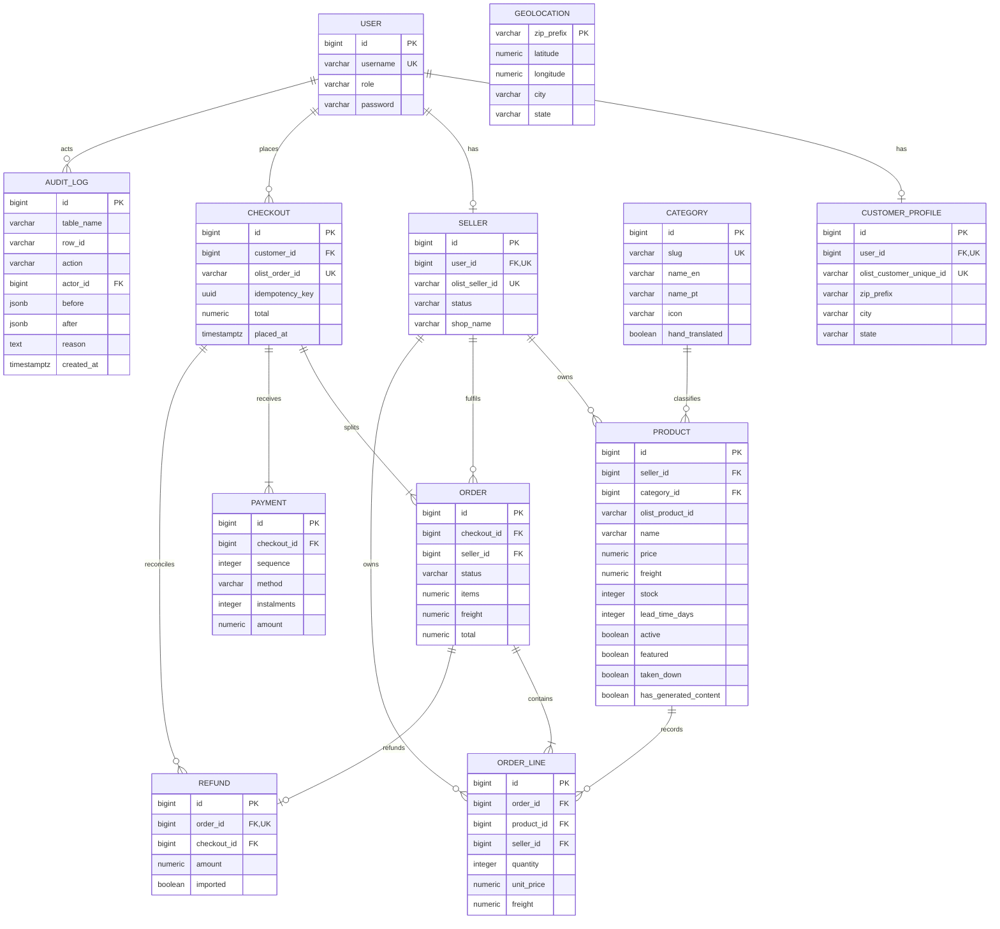

# Data model

The field ownership contract is in [AGENTS.md](../AGENTS.md#architecture-and-ownership). PostgreSQL owns accounts,
product names and every transactional value; MongoDB owns descriptions, flexible attributes and reviews. Source Olist
files remain unchanged in `data/raw/olist/`, with SHA-256 checksums and [licence attribution](licenses/olist.txt).
The executable contract is [olist-import](plans/olist-import.md).

## PostgreSQL

All application surrogate keys are bigint identities. Olist identifiers are nullable source columns, never primary
keys. Money is `numeric(12,2)` with bounds that also reject PostgreSQL numeric NaN and infinity. Dates are timestamptz;
source timestamps shift by exactly 426 weeks and acquire Asia/Singapore local time before conversion to a stored instant.
Zip prefixes are strings, preserving leading zeros. They deliberately have no geolocation FK because source coverage is
incomplete. Ordinary CRUD uses Django's ORM; the bulk loader uses COPY.

### Tables and integrity

| Django model / physical table | Additional fields and database guarantees |
|---|---|
| accounts.User / accounts_user | AbstractUser's auth fields, groups and permissions; role CHECK allows customer, seller or operator. Imported passwords are unusable; no hashing in the loader. Django's standard auth join tables and session table remain |
| CustomerProfile / accounts_customerprofile | One user per profile and one profile per user; unique Olist customer identity. Multiple source customer addresses collapse to the latest retained purchase address, then source customer ID |
| Seller / accounts_seller | One user per seller; unique Olist seller ID; status CHECK includes pending, approved, rejected and suspended. Generated shop names carry has_generated_content |
| Category / catalogue_category | Unique English slug; English/Portuguese names, one sprite icon mapping and the hand_translated flag. Rich category definitions live in MongoDB |
| Product / catalogue_product | Unique (seller_id, olist_product_id) and (id, seller_id). Positive finite price; nonnegative finite freight, stock and lead time. Nullable weight_g, length_cm, height_cm and width_cm; active, featured, taken_down, taken_down_reason, has_generated_content and demo_adjustment. Historical products are protected from deletion |
| Checkout / orders_checkout | customer_id references the user's ID. Unique (customer_id, idempotency_key); imported keys are null, Olist order ID is unique. Nonnegative finite total |
| Order / orders_order | Unique (checkout_id, seller_id), (id, seller_id) and (id, checkout_id). Status CHECK: placed, paid, shipped, delivered, cancelled. Nonnegative finite items/freight/total; total = items + freight. placed_at, paid_at, shipped_at, delivered_at, cancelled_at, estimated_delivery. Index on (seller_id, placed_at) |
| OrderLine / orders_orderline | Positive quantity and unit price; nonnegative freight. Composite FKs (order_id, seller_id) and (product_id, seller_id) enforce ownership with ON DELETE RESTRICT. shipping_limit_at is the earliest original item's shifted deadline when repeated lines collapse |
| Payment / orders_payment | Unique (checkout_id, sequence); positive sequence and instalments. Method CHECK: credit_card, boleto, voucher, debit_card; nonnegative finite amount. A row means money received; there is no payment-status column and no card-number field |
| Refund / orders_refund | At most one per order; composite FK (order_id, checkout_id) prevents cross-checkout refunds. Nonnegative finite amount; reason, refunded_at and imported. Imported cancellations with payments receive their full order total |
| AuditLog / audit_log | Written only by triggers. table_name, row_id as text (so MongoDB IDs also fit), action, nullable actor FK (PROTECT; NULL means a system change), before/after JSONB snapshots of named fields only, reason and created_at (database default now()). CHECKs: identity fields nonblank; a non-NULL actor needs a non-blank reason. Indexes: (created_at DESC, id DESC) for the newest-first page, and action |
| Geolocation / accounts_geolocation | One row per zip prefix, median coordinates and separate modal city/state (lexical tie-break). Coordinates use exact numeric columns |

Django creates B-tree indexes for ordinary FKs, primary keys and unique constraints. The initial migrations are
`src/accounts/migrations/0001_initial.py`, `src/catalogue/migrations/0001_initial.py` and
`src/orders/migrations/0001_initial.py`. The composite FKs are explicit migration SQL because Django does not express
these two-column relationships as ordinary ForeignKey fields.

### View, triggers and privileges

`purchasable_product` is the single visibility definition: an active product, not taken down, belonging to an approved
seller. It includes sold-out products. It uses security_invoker and exposes product rows. The minimum pages query its
IDs through an unmanaged ORM model. Later workstreams reuse this definition.

The customer_profile_role and seller_profile_role triggers require the linked user's role to match the profile;
user_profile_role prevents changing a role while an incompatible profile exists. The profile check locks the user row
in SHARE mode. These are schema guards; the seller status and audit triggers below come from accounts, and payment
triggers belong to checkout. The importer disables USER triggers only on loaded tables, retains FK/check/unique
constraints, flushes deferred FK events before restoring triggers, and runs the explicit reconciliation queries.
A failed transaction rolls back COPY and trigger changes together.
The loader requires a standalone owner transaction, so it cannot commit MongoDB inside a caller's uncommitted
PostgreSQL transaction. Compensation removes only IDs attempted by that import. An uncertain final commit or failed
cleanup is reported as requiring the documented local reset, without claiming a distributed atomic commit.
MongoDB loads commit bounded batches to respect transaction lifetime/cache limits; later failures compensate already
committed batches as well as the current batch. Progress is printed during large collection loads.

**Seller status and audit (`accounts` 0002).** seller_status_transition (BEFORE UPDATE, only
`WHEN (OLD.status IS DISTINCT FROM NEW.status)`) allows pending → approved or rejected, approved → suspended and
suspended → approved; rejected is terminal, and any other change fails with SQLSTATE 23514. Unchanged status and
shop-name edits pass without an audit row. seller_status_audit (AFTER UPDATE, same WHEN) inserts one audit_log row named
seller.approve, seller.reject, seller.suspend or seller.reinstate in the same transaction, with id, user_id, status and
shop_name snapshots. Its actor and reason come from the transaction-local settings `mercer.actor_id` and
`mercer.audit_reason`, which [accounts/audit.py](../src/accounts/audit.py) sets together with bound `set_config(..., true)`
on every action and which clear at commit or rollback; the trigger reads them with `NULLIF(current_setting(..., true), '')`.
The operator service locks the seller row (`SELECT ... FOR UPDATE`), rechecks the expected status, sets the context and
updates, so a stale or repeated action fails without a second row. Suspension hides products through
purchasable_product; reinstatement restores those otherwise eligible.

Both functions are owned by the migration owner, schema-qualified and pinned to `search_path = public, pg_temp`; only
the audit function is SECURITY DEFINER, because it alone writes a table the runtime role cannot. The migration revokes
runtime INSERT, UPDATE, DELETE and TRUNCATE on audit_log and every privilege on its identity sequence, keeping SELECT;
`grant_runtime` reapplies this after its broad grants (`TRIGGER_WRITTEN_TABLES` in
[config/privileges.py](../src/config/privileges.py)), so rerunning it cannot restore audit writes. Runtime cannot own or
replace functions, disable triggers, create temporary objects or change session_replication_role. Revoking PUBLIC
EXECUTE on the functions is hygiene only. Later catalogue and checkout triggers reuse this boundary.

The first accounts migration grants the runtime role access to tables/sequences and installs default privileges for
later owner-created objects. It applies equally to mercer and pytest's test_mercer. PUBLIC database privileges and
schema CREATE are revoked; runtime receives CONNECT, schema USAGE, row DML and sequence USAGE/SELECT, without CREATE,
TEMP, DROP, ALTER or TRUNCATE. The owner remains responsible for migrations, tests and import. Role identifiers are
quoted with psycopg Identifier; data values are bound parameters.
`django_migrations` is an explicit exception to row DML: runtime has SELECT only and no access to its identity
sequence, so only the owner can modify migration history in either the application or test database.

### Normalisation (3NF)

Each base table describes one entity, with a surrogate primary key and explicit source/business candidate keys.
Customer location depends on its profile, seller details on its seller, and category labels on their category;
products reference them instead of repeating those descriptions. A product belongs to one seller. Checkout payments
are separate from seller orders, so splitting an order cannot multiply payments. Each payment/refund is its own fact.
Order lines resolve the many-to-many relationship between orders and products and retain historical unit prices.
Those historical prices are facts about a sale, independent of the current catalogue price.

The composite ownership keys are deliberate redundancy needed for declarative cross-table enforcement: seller_id in a
line must agree with both its parent order and product. Stored totals are deliberate transactional summaries, checked
against their components during import; they are the bounded, documented exceptions to a strictly minimal 3NF layout.
The approved checkout workstream adds commit-time money enforcement for new application writes. Repeating source
Olist IDs as provenance does not create a second application entity or an additional authoritative store.

## MongoDB

`mongo_setup` creates every collection, strict error validator and index idempotently, using the readWrite application
user. It verifies existing validators rather than calling collMod (which readWrite cannot use). An incompatible
validator produces a clear reset/schema-migration diagnostic. The user is restricted to the application database and
its test_ database. Tests use real test_mercer and clear only their documents.

| Collection | Identity, contents and indexes |
|---|---|
| reviews | _id and order_line_id identify a line review. Unique index on order_line_id; non-unique Olist review ID index, since source IDs repeat; compound (product_id, answered_at descending). References order, checkout, product, seller and customer IDs in PostgreSQL. Score 1–5; Portuguese/English title/text, machine_translated, from_order_review, source ID, created_at and answered_at |
| product_specs | _id is the PostgreSQL product ID. Required category_id, description, flexible attributes, nullable photo_file_id, rating_summary, latest_reviews and has_generated_content. Index on category_id. No transactional price, stock or product name is stored here |
| platform_stats | Singleton bayesian document with m (mean score) and C (median review count across retained seller-products, including zero-review products). Exact Decimal128 values are fixed at cleaning time |
| category_templates | _id is category ID; unique category_id, attribute definitions, rich flag, generation label and version. Rich templates for the source profile's top categories; generic template elsewhere. Template documents can evolve without a collection-validator change |

Specification validators constrain the outer shape, required summary fields and a latest-review array of at most five.
They do not constrain category-specific attribute keys. Counts/sums are integers; average and Bayesian scores are
Decimal128. NDJSON uses Extended JSON $numberDecimal and $date values, preserving exact numbers and instants.

Descriptions, attributes, rating summaries and the latest five reviews are **embedded** in the bounded specification
because the detail page needs one MongoDB read. The complete, potentially unbounded review history is **referenced** in
reviews by product ID. Latest-review copies are a subset within MongoDB, not a copy of PostgreSQL data. An original
order review is copied to every collapsed order line; from_order_review labels multi-line adaptation. Reviews of
undelivered orders remain historical evidence. The later reviews workstream adds editing/UI and atomic maintenance.

Cross-store reconciliation verifies each review's line/order/checkout/product/seller/customer tuple, every spec's
product/category and each category template. Raw-versus-imported delivery analysis counts one review per checkout,
avoiding the bias that copying an order review to several lines would otherwise introduce.

## Reproducible pipeline

[The approved rule list](plans/olist-import.md#contract) is authoritative. Cleaning reads all raw CSVs as strings,
validates references/enums/dates/money and writes sorted CSV/NDJSON with stable LF newlines. IDs come from sorted source
keys; source addresses use a documented deterministic choice. Imported account date_joined uses the earliest observed
source purchase for the customer or seller (or the dataset's earliest purchase if no activity exists); Olist has no
signup date. Each item price/freight is converted and rounded half-up before equal-price repeats collapse. Checkout
payments are allocated proportionally, with the remainder on the largest
source payment (lowest sequence breaks ties). Product list price uses the median converted item price; product freight
uses the median collapsed line freight. Products left without retained lines disappear.

`data/derived/olist/fx.json` records the ECB publication and retrieval dates, EUR/BRL and EUR/SGD and their exact cross
rate; the unchanged XML response is stored beside it. The reference available on execution day precedes the European
publication later that day; dates are recorded honestly rather than relabelling the earlier fixing.

Names, descriptions, attributes, stock and lead times are generated with fixed seed 82 and labelled. A SHA-256 seed per
source product/seller isolates a product from unrelated row ordering. Templates are maintained in
`data/derived/olist/templates/categories.json`; generated category documents use the same definitions. Demo stock/lead
time adjustments have explicit labels and do not change historical transactions. Olist has no cancellation timestamp;
imported cancellation/refund dates conservatively use purchase time, recorded in the ledger.

The ledger's source counters obey read = kept + removed; transformed is a subset of kept, including grouping inputs.
Separate output counters account for customer merging, seller-products, split orders, collapsed lines and review copies.
Rule counters overlap and therefore must not be summed to obtain unique removed orders. The ledger includes source-file
hashes, fixed FX/date rules and generation provenance. Checksums cover every clean file and the complete derived tree.
[The loader and invariant queries](../src/config/olist_import.py) are the executable reconciliation source.

<!-- generated by analytics/profile_olist.py -->
## Dataset profile

| Source table | Rows |
|---|---:|
| customers | 99,441 |
| geolocation | 1,000,163 |
| order_items | 112,650 |
| order_payments | 103,886 |
| order_reviews | 99,224 |
| orders | 99,441 |
| products | 32,951 |
| sellers | 3,095 |
| categories | 71 |

| Profile finding | Value |
|---|---:|
| payment mismatches | 576 |
| one cent mismatches | 273 |
| shared products | 1,225 |
| seller products before cleaning | 34,448 |
| shared product lines | 14,416 |
| repeated line groups | 7,088 |
| repeated line excess | 10,225 |
| multi seller orders | 1,278 |
| duplicate review ids | 814 |
| orders with duplicate reviews | 547 |
| superseded reviews | 551 |
| uncategorised products | 610 |
| customers with leading zero zip | 23,995 |
| zero instalment payments | 2 |
| categories without source translation | 2 |
| geolocation unique prefixes | 19,015 |
| geolocation exact duplicates | 261,831 |

Purchase coverage: 2016-09-04 21:15:19 to 2018-10-17 17:30:18.

| Delivery delay | Reviewed orders | Average score |
|---|---:|---:|
| early_over_7 | 70,929 | 4.3168 |
| early_up_to_7_or_on_time | 18,514 | 4.1890 |
| late_1_to_7 | 3,600 | 2.7142 |
| late_8_to_14 | 1,446 | 1.6708 |
| late_over_14 | 1,335 | 1.7236 |

| Category (top 15) | Source item rows |
|---|---:|
| cama_mesa_banho | 11,115 |
| beleza_saude | 9,670 |
| esporte_lazer | 8,641 |
| moveis_decoracao | 8,334 |
| informatica_acessorios | 7,827 |
| utilidades_domesticas | 6,964 |
| relogios_presentes | 5,991 |
| telefonia | 4,545 |
| ferramentas_jardim | 4,347 |
| automotivo | 4,235 |
| brinquedos | 4,117 |
| cool_stuff | 3,796 |
| perfumaria | 3,419 |
| bebes | 3,065 |
| eletronicos | 2,767 |

## Cleaning ledger

Kept counts refer to source rows before expansions or grouping; transformed is a subset of kept.
Every table satisfies read = kept + removed. Output counts describe the separate adapted schema.

| Source | Read | Kept | Removed | Transformed |
|---|---:|---:|---:|---:|
| categories | 71 | 71 | 0 | 71 |
| customers | 99,441 | 99,441 | 0 | 99,441 |
| geolocation | 1,000,163 | 1,000,163 | 0 | 1,000,163 |
| order_items | 112,650 | 111,142 | 1,508 | 111,142 |
| order_payments | 103,886 | 102,436 | 1,450 | 102,436 |
| order_reviews | 99,224 | 97,330 | 1,894 | 97,330 |
| orders | 99,441 | 98,074 | 1,367 | 98,074 |
| products | 32,951 | 32,720 | 231 | 32,720 |
| sellers | 3,095 | 3,095 | 0 | 3,095 |

Rule counts overlap; the union of removed order IDs determines the surviving history.

| Rule | Affected |
|---|---:|
| 1 | 20 |
| 2 | 776 |
| 3 | 576 |
| 4 | 3 |
| 5 | 14 |
| 6 | 2 |
| 7 | 551 |
| 8 | 1,497 |
| 9 | 9,595 |
| 10 | 1,164 |
| 11 | 98,074 |
| 12 | 981,148 |
| 13 | 98,074 |
| 14 | 111,142 |
| 15 | 13,538 |
| 16 | 34,211 |
| 17 | 460 |
| 18 | 237 |

| Adapted output | Rows |
|---|---:|
| categories | 74 |
| category_templates | 74 |
| checkouts | 98,074 |
| customers | 96,096 |
| geolocation | 19,015 |
| order_lines | 101,547 |
| orders | 99,295 |
| payments | 102,436 |
| platform_stats | 1 |
| product_specs | 34,211 |
| products | 34,211 |
| refunds | 460 |
| reviews | 100,758 |
| sellers | 3,095 |
| users | 99,191 |
<!-- end generated -->

## Catalogue search and product audit

`catalogue` 0002 adds the trusted pg_trgm extension and the `product_name_trgm` GIN index on product.name.
`product_update_audit` runs AFTER UPDATE only when price, stock, active or taken_down actually changes. The
owner-owned SECURITY DEFINER function `public.audit_product_update()` pins `search_path = public, pg_temp`, reads
the shared transaction-local actor/reason settings and writes named-field before/after snapshots to audit_log.
Runtime retains SELECT only on audit_log and cannot execute or replace the function or disable its trigger.
MongoDB `spec_attributes` is an `attributes.$**` wildcard index: fields added to templates are indexed without
collection-schema changes; array-valued fields use multikey entries, while the imported scalar fields do not.
